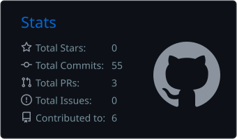
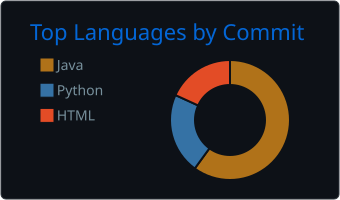

  

  

  <a href="https://www.linkedin.com/in/carlos-farinha-7a518b157/">LinkedIn</a> ·
  <a href="mailto:gouveiafarinha90@gmail.com">Email</a> ·
  <a href="https://ruvylo.com">Ruvylo</a>

## About Me

IT technician with **~6 years of hands-on technical support experience** and a 3rd-year **Computer Science and Engineering** student at the University of Beira Interior (UBI), Portugal.

I'm also the founder of **[Ruvylo](https://ruvylo.com)**, a SaaS platform that helps small technical-assistance businesses manage clients, service requests, statuses, payments and alerts from one dashboard.

I'm looking for **remote roles in IT support, software implementation or junior development**.

## Tech Stack

  

Also: Microsoft SQL Server (T-SQL), JavaFX, Tkinter, gunicorn, Cloudflare Tunnel, Windows Server, computer networks and hardware troubleshooting.

## Featured Projects

| Project | Description | Stack |
|---|---|---|
| [Repair Service Manager](https://github.com/MooniePT/repair-service-manager) | Web app I built and run in production to manage IT repair jobs, clients and parts orders, with dashboards, Docker deployment and Cloudflare zero-trust access. The prototype that inspired Ruvylo. | Python, Flask, SQLite, Docker |
| [A Minha Dieta](https://github.com/MooniePT/AminhaDieta) | Desktop app for tracking diet, hydration and exercise, with charts, PDF reports and an MVC architecture. Team project, UBI. | Java, JavaFX, Maven |
| [NEO Monitor](https://github.com/MooniePT/NEO_Monitor_BD_Project) | SQL Server database and Python GUI for monitoring near-Earth asteroids, with ~966k real orbital records and ESA risk lists. Team project, UBI. | Python, T-SQL, Tkinter |
| [OnMemory Website](https://github.com/MooniePT/ProjetoOnMemory) ([live](https://mooniept.github.io/ProjetoOnMemory/)) | Responsive website for a computer repair and IT support company. Training project. | HTML, CSS, Bootstrap |
| [Ruvylo](https://ruvylo.com) | SaaS platform for technical-assistance businesses (founder). | SaaS |

## GitHub Stats

  
  

  <picture>
    <source media="(prefers-color-scheme: dark)" srcset="https://raw.githubusercontent.com/MooniePT/MooniePT/output/github-snake-dark.svg" />
    <source media="(prefers-color-scheme: light)" srcset="https://raw.githubusercontent.com/MooniePT/MooniePT/output/github-snake.svg" />
    
  </picture>

